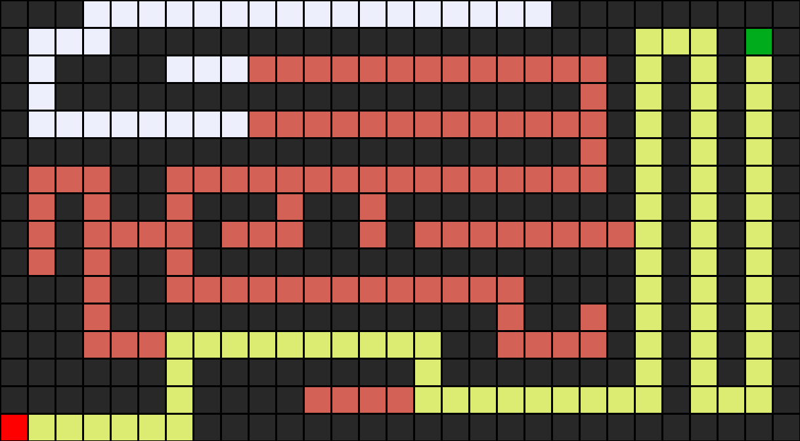

# Intelligent Maze Pathfinder

A Python implementation and comparison of **Iterative Deepening Search (IDS)**, **A\* Search**, and **Iterative Deepening A\* (IDA\*)** for solving unit-cost grid mazes.

This project demonstrates classical artificial-intelligence search techniques, path reconstruction, heuristic search, algorithm benchmarking, and maze visualisation without relying on a pathfinding library.



## Highlights

- Implements **IDS**, **A\***, and **IDA\*** from scratch.
- Uses **Manhattan distance** for informed search.
- Reconstructs the final path using parent references.
- Reports action sequence, path cost, path length, explored states, and runtime.
- Generates PNG visualisations of the solution and explored cells.
- Includes the original project mazes used for testing.
- Includes automated tests and a benchmark script.
- Fixes the original IDS depth-50 cutoff so the 71-step `maze2.txt` solution can be found.

## Search problem

| Component | Definition |
| --- | --- |
| State | Current `(row, column)` position |
| Initial state | Cell marked `A` |
| Goal state | Cell marked `B` |
| Actions | `U`, `D`, `L`, `R` |
| Step cost | 1 per move |
| Traversable cell | Space character |
| Wall | Any other character except `A` and `B` |
| Heuristic | Manhattan distance |

A\* and IDA\* evaluate nodes using:

```text
f(n) = g(n) + h(n)
```

where `g(n)` is the path cost from the start and `h(n)` is Manhattan distance to the goal.

## Repository structure

```text
intelligent-maze-pathfinder/
├── README.md
├── benchmark.py
├── requirements.txt
├── src/
│   ├── __init__.py
│   └── maze.py
├── examples/
│   ├── maze1.txt
│   ├── maze2.txt
│   └── maze3.txt
├── results/
│   ├── benchmark.txt
│   ├── maze1_astar.png
│   ├── maze2_astar.png
│   └── maze3_astar.png
├── docs/
│   ├── ALGORITHMS.md
│   └── original_assignment_version.py
└── tests/
    └── test_maze.py
```

## Installation

Clone the repository:

```bash
git clone https://github.com/YOUR-USERNAME/intelligent-maze-pathfinder.git
cd intelligent-maze-pathfinder
```

Create a virtual environment:

```bash
python -m venv .venv
```

Activate it on Windows PowerShell:

```powershell
.venv\Scripts\Activate.ps1
```

Install the optional image dependency:

```bash
pip install -r requirements.txt
```

The search algorithms use only the Python standard library. `Pillow` is used to generate PNG visualisations.

## Usage

### A* Search

```bash
python src/maze.py examples/maze2.txt --algorithm astar
```

### Iterative Deepening Search

```bash
python src/maze.py examples/maze2.txt --algorithm ids
```

### IDA*

```bash
python src/maze.py examples/maze2.txt --algorithm idastar
```

### Run all algorithms

```bash
python src/maze.py examples/maze2.txt --algorithm all
```

### Save a visualisation

```bash
python src/maze.py examples/maze2.txt --algorithm astar --output results/maze2_astar.png --show-explored
```

## Example output

```text
Algorithm: A*
Path cost: 71
Path length: 71
States explored: 172
```

The exact runtime varies between machines and runs.

## Benchmarking

Run all algorithms against all included mazes:

```bash
python benchmark.py
```

The latest local run is stored in [`results/benchmark.txt`](results/benchmark.txt).

| Maze | IDS explored | A* explored | IDA* explored | Optimal path |
| --- | ---: | ---: | ---: | ---: |
| Maze 1 | 66 | 11 | 11 | 10 |
| Maze 2 | 6,833 | 172 | 1,773 | 71 |
| Maze 3 | 18 | 5 | 6 | 4 |

All three algorithms find the same optimal path length on the included unit-cost mazes, but their amount of exploration differs significantly. Runtime is intentionally kept in `results/benchmark.txt` rather than hard-coded here because timing varies by machine and run.

## Visualisation legend

- **Red:** start state
- **Green:** goal state
- **Yellow:** solution path
- **Muted red:** explored state
- **Dark grey:** wall
- **Light grey:** free cell

## Tests

Run:

```bash
python -m unittest discover tests
```

The test suite checks the expected path lengths on the three supplied mazes and specifically verifies that IDS is no longer incorrectly cut off at depth 50 on Maze 2.

## Algorithm notes

More detail on IDS, A\*, IDA\*, Manhattan distance, admissibility, consistency, and algorithm trade-offs is available in [`docs/ALGORITHMS.md`](docs/ALGORITHMS.md).

## Project background

This project originated from an Intelligent Systems search-strategies assignment and was later refactored into a portfolio-oriented repository. The portfolio version keeps the underlying search ideas while improving the command-line interface, code organisation, reproducibility, tests, and documentation.

The submitted assignment version is retained in `docs/original_assignment_version.py` for reference.
